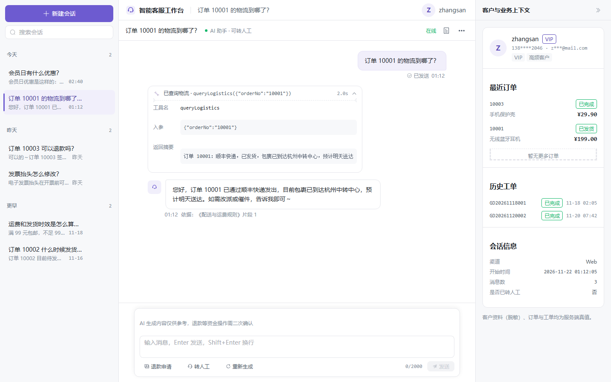
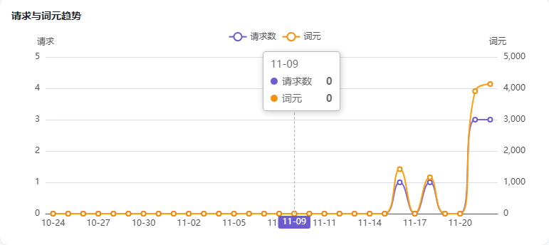
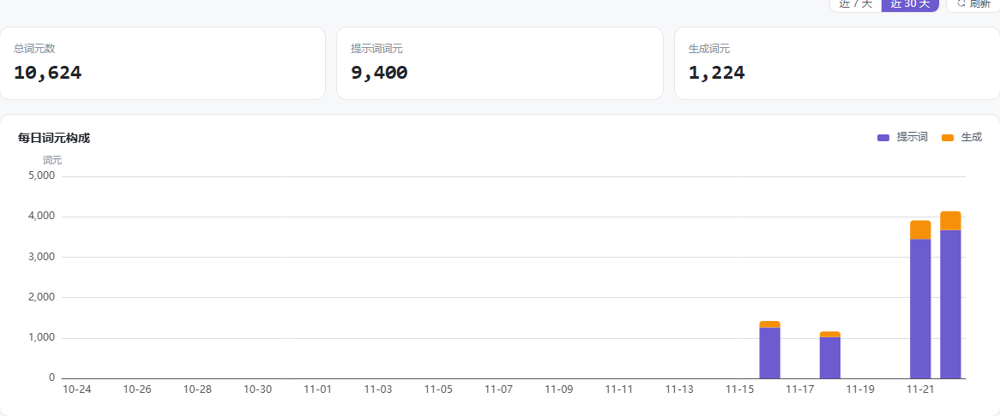

# AI 智能客服系统

基于 Spring Boot 4 + Spring AI + Vue3 的全链路电商智能客服：SSE 流式问答、RAG 知识库溯源、
Tool Calling 业务工具、转人工工单、双端界面与容器化部署，配套可重复运行的验收断言矩阵。

## 功能

- 用户端：流式对话（含溯源引用）、订单/物流卡片、退款两步确认、转人工排队、历史会话回看、移动端自适应
- 管理端：仪表盘、订单、退款、工单、知识库、对话审计、请求日志、词元统计、响应时间、系统监控共 10 页
- 后端：Session + BCrypt 真实登录与 USER/ADMIN 鉴权、IP 限流、防 XFF 伪造、审计与请求级观测落库

## 技术栈

| 组件 | 版本/说明 |
| --- | --- |
| Spring Boot / Java | 4.2.0 / 17+ |
| Spring AI | 2.1.0（DeepSeek 聊天 + Chroma 向量库 + 硅基流动 bge-m3 嵌入） |
| 前端 | Vue3 + TS + Vite + Element Plus + Pinia + Tailwind v4 + ECharts |
| 存储 | MySQL 8（JPA）、Chroma 1.5.9（向量）、Redis 7（预留） |
| 部署 | Nginx 前后端分离 + Docker Compose（mysql/redis/chroma/app/nginx） |
| 测试 | JUnit MockMvc、vitest、Playwright 验收矩阵 |

## 界面展示

用户工作台（三栏 + 工具调用条）：



管理端仪表盘（双轴网格线对齐、Tooltip 防遮挡、轴标签高亮）：



词元统计（图例与标题同行、零数据日阴影带与吸附 Tooltip）：



## 快速开始

```bash
cp .env.example .env        # 填写 DEEPSEEK_API_KEY 与 SILICONFLOW_API_KEY
mvn package -DskipTests     # Dockerfile 只 COPY target 内 jar，须先打包
docker compose -f docker-compose.yml -f docker-compose.verify.yml up -d --build
# 统一入口 http://localhost （nginx）；app 仅 loopback 8080
cd frontend && npm install && npm run dev   # 开发态 http://localhost:5173
```

- 演示账号：zhangsan/123456、lisi/123456（USER），admin/Admin@123（ADMIN）
- 演示基线：`mysql ... -e "source eval/seed-ui-demo.sql"`（在项目根执行，重置会话/工单/退款/知识库）
- IDEA 本地运行：运行配置注入 .env 两个 Key 环境变量后启动 `AiCustomerServiceApplication`

## 项目结构

```
src/main/java/.../aicustomerservice   控制器/服务/工具/拦截器/实体（controller、service、tool、config…）
src/main/resources                    application.yml、外置系统提示词、知识库种子 md
frontend/                             Vue3 工程；scripts/ 内为 Playwright 验收套件
deploy/                               nginx.conf 与反代 include
eval/                                 基线种子 SQL、模型效果评估与后端验收矩阵脚本
docs/                                 部署指南、前端架构设计、展示截图
```

## 核心设计

- **RAG 与向量库**：知识库以 DB 为准，启动/CRUD 按 docId 幂等同步 Chroma（重启不重复、删除无孤儿向量）；
  嵌入走硅基流动 BAAI/bge-m3（1024 维、cosine）；检索 topK=3、阈值 0.3，回复带真实溯源引用
- **记忆与审计分离**：ChatMemory 经 JDBC 持久化，键为 `userId::conversationId` 防跨用户串记忆；
  ai_chat_message 负责审计与历史回看，ai_request_log 记录模型/词元/耗时
- **工具与高风险操作**：订单/物流/退款资格三工具真实入参真实耗时；退款"申请-确认"两步，
  模型无权执行退款；订单卡字段以 DB 真值渲染防幻觉
- **安全**：Session + BCrypt；AdminInterceptor 真 401/403；每 IP 60 次/分钟限流；
  可信代理段收窄 + X-Real-IP 防伪造；输出对密钥串脱敏；提示词注入拒绝
- **图表工程化**：双 Y 轴网格线逐条对齐、Tooltip confine + 类目中心吸附、轴标签 hideOverlap、
  零数据日阴影带反馈，均固化为像素/几何回归断言

## 测试与验收

```bash
mvn test                                   # 后端集成测试（独立 accept schema）
cd frontend && npm test                    # vitest 单测
pwsh eval/run-eval.ps1 -BaseUrl http://localhost:8080   # 模型效果固定 6 题
pwsh eval/acceptance-matrix.ps1            # 后端/联调实测矩阵（含 DB 核验）
node frontend/scripts/debt-acceptance.mjs      # 业务债务 33 断言
node frontend/scripts/admin-acceptance.mjs     # 管理端 34 断言
node frontend/scripts/ui-acceptance.mjs        # 桌面 UI 30 断言
node frontend/scripts/mobile-acceptance.mjs    # 移动视口 12 断言
node frontend/scripts/nginx-smoke.mjs          # 部署冒烟 11 断言
node frontend/scripts/zombie-session-check.mjs # 僵尸会话 5 断言
node frontend/scripts/chart-axis-check.mjs     # 图表像素/几何 13 断言
node frontend/scripts/session-expiry-check.mjs # 会话过期 5 断言
```

最近一轮全矩阵 143/143 通过、浏览器控制台 0 错误。Playwright 套件需先 `npx playwright install chromium`；
发模型消息的套件之间间隔 ≥60s 并重跑基线种子（限流桶为进程内）。

## 文档

- [Nginx 前后端分离部署指南](docs/Nginx前后端分离部署.md)
- [前端架构设计](docs/前端架构设计.md)

## 已知限制

- Chroma 集合维度锁定 1024：换嵌入模型须先删集合；启动全量重算文档（量大需加内容哈希跳过）
- 嵌入走外部 API：断网不可用；免费额度 L0 2000 RPM / 500K TPM，批量重建留意限流
- 限流桶为进程内实现：多实例部署需外置（Redis 已预留未接入）